# ⏰ Math Alarm & Screen Pinning (Android Kiosk)

Aplikasi Alarm pintar berbasis **Ionic + React + Capacitor** dengan integrasi mendalam ke **Android Native API**. Aplikasi ini dirancang agar pengguna tidak bisa sembarangan mematikan atau mengabaikan alarm saat berbunyi:

1. **Tetap Berbunyi & Muncul Layar Penuh Meskipun Aplikasi Ditutup Total (*Killed / Closed*)** atau perangkat dalam keadaan terkunci (*screen lock / keyguard*).
2. **Otomatis Masuk Mode Sematan Layar (*Screen Pinning / Lock Task*)** saat alarm berbunyi.
3. **Kuis Matematika Wajib**: Layar terkunci menampilkan soal matematika acak (misal `15 + 9 = ?`).
4. **Otomatis Buka Kuncian (*Auto-Unpin*)**: Setelah jawaban benar dikirim, layar otomatis di-unpin (*unlocked*) dan suara alarm/getaran langsung berhenti.
5. **Bypass Konfirmasi "Got it"**: Dilengkapi fitur **Device Owner (Lock Task Allowlist)** sehingga perangkat langsung tersemat secara instan dan senyap (*silent*) tanpa perlu menekan tombol konfirmasi *"Got it"*.

---

## 🛠️ Tech Stack

| Lapisan / Komponen | Teknologi & Versi | Kegunaan |
|---|---|---|
| **Frontend Framework** | **React 19** + **TypeScript** | Struktur komponen UI, logika state kuis matematika, keypad kalkulator virtual |
| **Mobile UI Toolkit** | **Ionic Framework 8** (`@ionic/react`) | Komponen responsif Android/iOS (IonPage, IonContent, dll.) |
| **Build Tool & Bundler** | **Vite 8** (`@vitejs/plugin-legacy`) | Kompilasi kilat, bundler modern, dan polifill web view Android |
| **Native Bridge** | **Capacitor 8** (`@capacitor/core`, `@capacitor/cli`) | Jembatan komunikasi dua arah antara antarmuka Web dan modul Java Native |
| **Android SDK / Runtime** | **Java 17**, **Android SDK 34 - 36** (Target SDK 36) | Kompilasi bytecode Android dan pemanfaatan API platform terbaru |
| **Audio & Getaran** | `MediaPlayer`, `Vibrator` / `VibratorManager` | Memutar nada dering alarm secara looping dan efek getar berulang |
| **Power Management** | `PowerManager.WakeLock` | Membangunkan CPU dan menyalakan layar dari mode tidur lelap (*Doze / Deep Sleep*) |
| **Security & Policy** | `DevicePolicyManager`, `DeviceAdminReceiver` | Mode Kiosk Enterprise (*Lock Task Mode*) tanpa dialog konfirmasi *"Got it"* |

---

## 🔄 Flowchart Alur Sistem

### 1. Alur Siklus Hidup Alarm (End-to-End Lifecycle)

```mermaid
flowchart TD
    A([Mulai]) --> B[Pengguna Mengatur Jam & Menit / Uji Coba Cepat]
    B --> C[ScreenPinningPlugin.setAlarm dipanggil]
    C --> D[AlarmManager.setAlarmClock dijadwalkan dengan BAL Creator Options]
    D --> E[Pengguna Menutup Aplikasi Total / Layar Terkunci]
    
    E -->|Waktu Alarm Tiba| F[Sistem Android Membangunkan Perangkat & Memicu AlarmReceiver]
    
    F --> G[Ambil WakeLock: Bangunkan CPU & Nyalakan Layar]
    G --> H[Mulai Loop Audio MediaPlayer & Getaran Vibrator]
    H --> I[Simpan Status is_alarm_active ke SharedPreferences]
    I --> J[Tampilkan Full-Screen Intent Notification]
    J --> K[Luncurkan MainActivity dengan FLAG_ACTIVITY_NEW_TASK & BAL Exemption]
    
    K --> L[MainActivity: setShowWhenLocked, setTurnScreenOn & dismissKeyguard]
    L --> M[WebView Memuat Home.tsx & Memeriksa checkAlarmState]
    M --> N[Antarmuka Berubah ke Layar Kuis Matematika 'ALARM BERBUNYI!']
    N --> O[Panggil ScreenPinning.startPinning]
    
    O --> P{Apakah Device Owner Aktif?}
    P -- Ya --> Q[LockTaskController: Langsung Pinned/LOCKED Tanpa Tombol Got It]
    P -- Tidak --> R[Screen Pinning Biasa: Muncul Konfirmasi Got It]
    
    Q --> S[Pengguna Mengetik Jawaban di Keypad Virtual]
    R --> S
    
    S --> T{Jawaban Benar?}
    T -- Salah --> U[Tampilkan Pesan 'Jawaban belum tepat' & Getar Salah]
    U --> S
    T -- Ya --> V[Panggil ScreenPinning.stopPinning]
    
    V --> W[stopLockTask: Lepaskan Sematan Layar]
    W --> X[Hentikan Audio & Getaran, Reset SharedPreferences]
    X --> Y[Tampilkan Layar Sukses 'Jawaban Benar!']
    Y --> Z([Selesai])
```



---

## 📱 Arsitektur Modul Native & Fungsinya

Seluruh kode native Android berada di direktori `android/app/src/main/java/io/ionic/starter/`:

### 1. `MainActivity.java`
Bertanggung jawab atas pengaturan window saat perangkat dalam kondisi terkunci serta routing intent alarm.

- **`configureWindowForAlarm()`**:
  - `setShowWhenLocked(true)`: Mengizinkan Activity ditampilkan di atas layar kunci (*Keyguard/Lockscreen*).
  - `setTurnScreenOn(true)`: Otomatis menyalakan panel layar fisik saat activity diluncurkan.
  - `KeyguardManager.requestDismissKeyguard(this, null)`: Menyingkirkan kunci layar sementara agar kuis alarm langsung dapat diakses.
  - `getWindow().addFlags(WindowManager.LayoutParams.FLAG_KEEP_SCREEN_ON)`: Mencegah layar mati saat kuis sedang berlangsung.
- **`onCreate(Bundle savedInstanceState)`**: Mendaftarkan plugin `ScreenPinningPlugin`, memanggil `configureWindowForAlarm()`, dan memproses intent alarm saat aplikasi dimulai dari kondisi mati (*cold start*).
- **`onNewIntent(Intent intent)`**: Memastikan window dikonfigurasi ulang dan alarm diproses saat aplikasi sudah berada di memori (*singleTask resume*).
- **`handleAlarmIntent(Intent intent)`**: Mengecek apakah intent membawa flag `EXTRA_ALARM_TRIGGERED` atau SharedPreferences aktif, lalu memicu event notifikasi ke React.

---

### 2. `AlarmReceiver.java`
`BroadcastReceiver` yang dieksekusi oleh sistem Android saat waktu alarm clock tercapai, bahkan saat proses utama aplikasi tidak berjalan.

- **`onReceive(Context context, Intent intent)`**:
  - **WakeLock Acquisition**: Membuat `PowerManager.PARTIAL_WAKE_LOCK | PowerManager.ACQUIRE_CAUSES_WAKEUP` selama maksimal 10 menit agar sistem tidak kembali tidur sebelum Activity siap.
  - **Audio & Getaran**: Memanggil `ScreenPinningPlugin.startAlarmSound(context)` untuk langsung memutar suara alarm.
  - **Status Persisten**: Menyimpan flag `is_alarm_active = true` pada `SharedPreferences` agar status tidak hilang jika proses terestart.
  - **Notifikasi Full-Screen**: Mengonfigurasi `NotificationChannel` dengan `IMPORTANCE_HIGH`, atribut suara `USAGE_ALARM`, serta memasang `setFullScreenIntent(pendingIntent, true)`.
  - **Android 14+ BAL Exemption**:
    ```java
    ActivityOptions actOptions = ActivityOptions.makeBasic();
    actOptions.setPendingIntentCreatorBackgroundActivityStartMode(
        ActivityOptions.MODE_BACKGROUND_ACTIVITY_START_ALLOWED
    );
    PendingIntent pendingIntent = PendingIntent.getActivity(
        context, 1001, launchIntent, pendingFlags, actOptions.toBundle()
    );
    ```
    Memastikan `system_server` Android 14/15 mengizinkan peluncuran Activity dari background tanpa terblokir `BAL_BLOCK`.

---

### 3. `ScreenPinningPlugin.java`
Plugin Capacitor (`@CapacitorPlugin(name = "ScreenPinning")`) yang menghubungkan UI React dengan fitur hardware dan sistem operasi Android.

| Method Native | Deskripsi & Kegunaan |
|---|---|
| `setAlarm(PluginCall call)` | Mendaftarkan alarm akurat menggunakan `AlarmManager.setAlarmClock()`. Menggunakan `AlarmClockInfo` yang merupakan jalur resmi Android untuk mendapatkan hak bangun prioritas tinggi. |
| `cancelAlarm(PluginCall call)` | Membatalkan jadwal alarm pada `AlarmManager` dan menghentikan audio dering jika sedang aktif. |
| `startPinning(PluginCall call)` | Memanggil `AdminReceiver.whitelistLockTask()` lalu mengeksekusi `activity.startLockTask()`. Mengunci antarmuka ke aplikasi saat ini. |
| `stopPinning(PluginCall call)` | Memanggil `activity.stopLockTask()` untuk membuka kuncian layar, dan menghentikan pemutaran audio/getaran melalui `stopAlarmSoundInternal()`. |
| `checkAlarmState(PluginCall call)` | Memeriksa nilai `is_alarm_active` dari `SharedPreferences`. Digunakan oleh React saat baru dimuat untuk mengetahui apakah dibuka karena alarm berbunyi. |
| `checkPermissions(PluginCall call)` | Memeriksa status 4 izin penting: `pinningEnabled`, `canFullScreen`, `canOverlay`, dan `isDeviceOwner` / `isLockTaskPermitted`. |
| `requestFullScreenPermission(PluginCall call)` | Membuka layar pengaturan Android `Settings.ACTION_MANAGE_APP_USE_FULL_SCREEN_INTENT` (Android 14+). |
| `requestOverlayPermission(PluginCall call)` | Membuka layar pengaturan `Settings.ACTION_MANAGE_OVERLAY_PERMISSION` ("Tampil di atas aplikasi lain"). |
| `openScreenPinningSettings(PluginCall call)` | Membuka layar pengaturan keamanan Android agar pengguna dapat mengaktifkan fitur App Pinning. |
| `enableKioskMode(PluginCall call)` | Memaksa pendaftaran ulang paket ke allowlist LockTask `DevicePolicyManager`. |
| `startAlarmSound(Context context)` | Memulai `MediaPlayer` dengan looping nada dering alarm default (`TYPE_ALARM`) dan `Vibrator` dengan pola getar berkala. |
| `stopAlarmSoundInternal(Context context)` | Mereset status alarm di `SharedPreferences`, melepaskan instans `MediaPlayer`, dan membatalkan getaran `Vibrator`. |

---

### 4. `AdminReceiver.java`
Turunan dari `DeviceAdminReceiver` yang menangani hak istimewa pengelolaan perangkat (*Device Administration & Kiosk Mode*).

- **`onEnabled(Context context, Intent intent)`**: Otomatis terpanggil saat aplikasi diberikan hak admin/owner.
- **`whitelistLockTask(Context context)`**:
  ```java
  DevicePolicyManager dpm = (DevicePolicyManager) context.getSystemService(Context.DEVICE_POLICY_SERVICE);
  ComponentName adminComponent = new ComponentName(context, AdminReceiver.class);
  if (dpm != null && dpm.isDeviceOwnerApp(context.getPackageName())) {
      dpm.setLockTaskPackages(adminComponent, new String[]{context.getPackageName()});
  }
  ```
  Mendaftarkan `io.ionic.starter` ke dalam daftar paket yang diizinkan untuk mode LockTask murni. **Inilah bagian yang menghilangkan dialog popup konfirmasi "Got it"**.

---

## 🔒 Konfigurasi Izin pada `AndroidManifest.xml`

```xml
<!-- Izin Alarm & Penjadwalan Tepat -->
<uses-permission android:name="android.permission.SCHEDULE_EXACT_ALARM" />
<uses-permission android:name="android.permission.USE_EXACT_ALARM" />

<!-- Izin Layar Penuh & Membangunkan Layar -->
<uses-permission android:name="android.permission.USE_FULL_SCREEN_INTENT" />
<uses-permission android:name="android.permission.WAKE_LOCK" />
<uses-permission android:name="android.permission.DISABLE_KEYGUARD" />

<!-- Izin Tampil di Atas Aplikasi Lain (Bypass BAL Android 10-15) -->
<uses-permission android:name="android.permission.SYSTEM_ALERT_WINDOW" />

<!-- Izin Notifikasi & Perangkat Fisik -->
<uses-permission android:name="android.permission.POST_NOTIFICATIONS" />
<uses-permission android:name="android.permission.VIBRATE" />
<uses-permission android:name="android.permission.RECEIVE_BOOT_COMPLETED" />
<uses-permission android:name="android.permission.FOREGROUND_SERVICE" />
```

---

## 🚀 Panduan Menjalankan & Menguji Aplikasi

### 1. Prasyarat Lingkungan
- **Node.js**: v18+ atau v20+
- **Java Development Kit (JDK)**: JDK 17
- **Android SDK Platform**: API 34 atau API 36
- **Android SDK Platform-Tools**: `adb` terinstal dan terdaftar di PATH / Local AppData

### 2. Kompilasi & Sinkronisasi
```bash
# 1. Install dependensi JavaScript
npm install

# 2. Build aset frontend React
npm run build

# 3. Sinkronisasi aset dan konfigurasi ke Android project
npx cap sync android

# 4. Kompilasi APK Debug menggunakan Gradle
cd android
./gradlew assembleDebug
cd ..
```

### 3. Pasang ke Emulator atau HP Fisik
```bash
adb install -r android/app/build/outputs/apk/debug/app-debug.apk
```

### 4. (Opsional tapi Sangat Disarankan) Mengaktifkan Mode Kiosk Tanpa Dialog "Got it"
Agar layar langsung ter-pin seketika tanpa perlu menekan tombol konfirmasi *"Got it"*, jadikan aplikasi sebagai **Device Owner**:
```bash
adb shell dpm set-device-owner io.ionic.starter/.AdminReceiver
```
> [!NOTE]
> Di Android Emulator, perintah di atas langsung berhasil seketika. Pada perangkat HP fisik baru, perintah dijalankan saat HP belum memiliki akun Google yang login atau setelah reset pabrik.

---

## 🧪 Skenario Pengujian yang Telah Diverifikasi

1. **Uji Coba Cepat 10 Detik**:
   - Buka aplikasi -> Tekan tombol **⚡ Uji Coba Cepat (Bunyi 10 Detik Lagi)**.
2. **Kondisi Aplikasi Mati Total (*Force Closed / Swiped Out*)**:
   - Tekan tombol Home dan matikan proses (`adb shell run-as io.ionic.starter kill -9 <pid>`).
3. **Hasil Verifikasi**:
   - Pada detik ke-10, sistem Android otomatis menyalakan layar, membunyikan alarm dan getaran.
   - Layar kuis matematika langsung muncul memenuhi layar dalam status `mLockTaskModeState=LOCKED`.
   - Tanpa dialog *"Got it"*, pengguna wajib mengisi jawaban matematika (misal: `10 + 13 = 23`).
   - Tombol **Kirim Jawaban & Matikan Alarm** ditekan: layar seketika di-unpin dan nada dering langsung berhenti sempurna.
